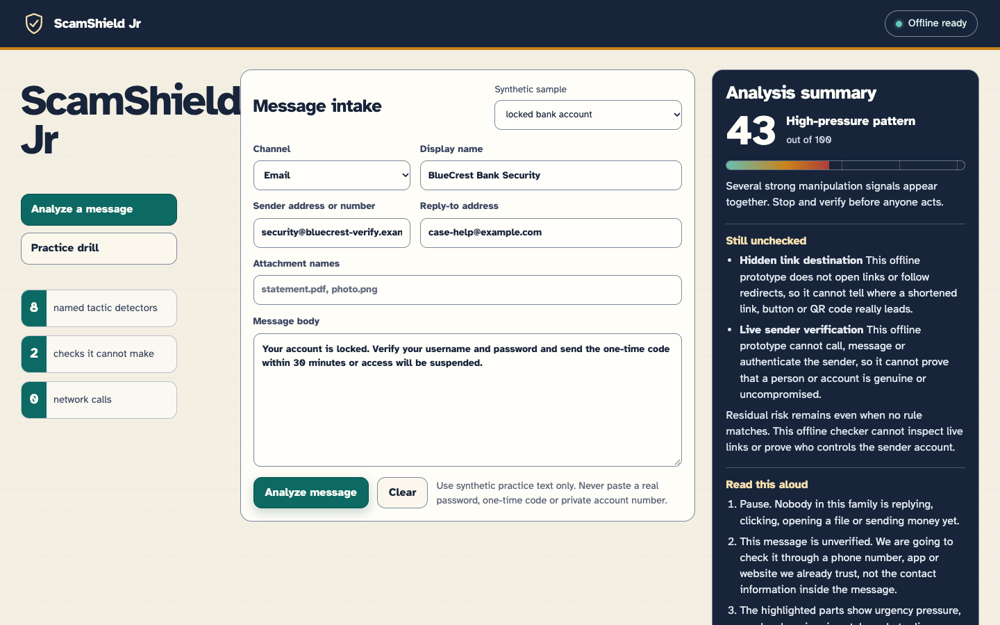
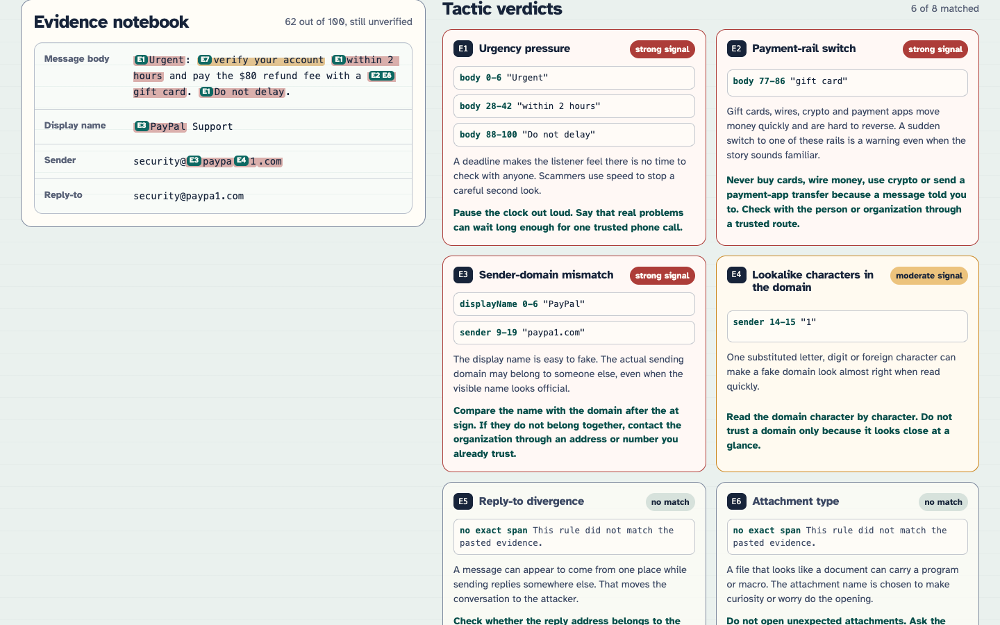
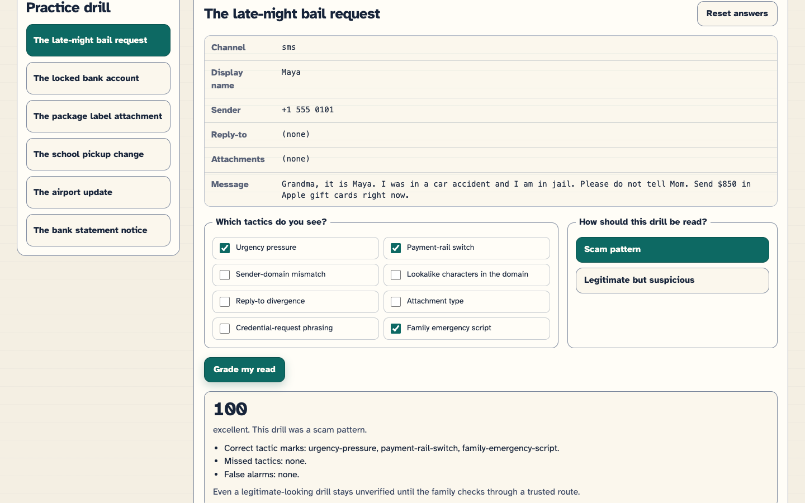

# ScamShield Jr

ScamShield Jr is an offline scam-message explainer for families. A student pastes a synthetic SMS, email or direct message, and the prototype shows which manipulation tactics appear, where they appear and what the family can say next.

The project is a working prototype for SafeSpace Hacks. It runs as static HTML, CSS and JavaScript with zero dependencies and no network calls.

## Intended user, risk and improvement

The intended user is a middle or high school student helping a grandparent inspect a suspicious message at home.

The situation is a moment of pressure. A message claims there is an emergency, a locked account, a package problem or a family crisis. The practical improvement is that the family gets specific evidence and a calm verification script instead of a bare warning or a false sense of certainty.

## What it does

- Scores a pasted message with eight deterministic tactic detectors.
- Highlights exact matched spans with field names and character offsets.
- Explains why each tactic works in plain language.
- Gives a short read-aloud script for the student and grandparent.
- Always shows residual risk and the two checks the offline prototype cannot make.
- Includes a drill mode with six synthetic messages, three scams and three legitimate-but-suspicious messages.
- Runs entirely offline after the static files are present.

## Tactic table

| Detector | What it flags | Synthetic example | Output |
| --- | --- | --- | --- |
| Urgency pressure | deadlines, threats and demands for immediate action | “Verify within 30 minutes” | matched span, severity and explanation |
| Payment-rail switch | gift cards, wires, crypto, payment apps and scan-to-pay instructions | “Send $850 in Apple gift cards” | matched span, severity and explanation |
| Sender-domain mismatch | display names that do not fit the sending domain | “BlueCrest Bank” from an unrelated domain | display-name and sender spans |
| Lookalike characters in the domain | digit substitution, Cyrillic or Greek homoglyphs and punycode-looking labels | `paypa1.com` read as `paypal.com` | exact character span and normalization |
| Reply-to divergence | replies routed to a different domain family | sender on one root, reply-to on another | sender and reply-to spans |
| Attachment type | executables, macro files, HTML files and archives | `shipping-label.pdf.exe` | attachment filename span |
| Credential-request phrasing | requests for passwords, one-time codes, identity numbers or payment details | “send the one-time code” | matched request span |
| Family emergency script | crisis, secrecy, bail, accident and money patterns | “do not tell Mom” plus bail money | clustered evidence spans |

The detector output is deterministic. Each detector has severity 0 to 3, a fixed weight and a nonlinear contribution so moderate and strong evidence count more than weak evidence. The total is shown out of 100. The labels are “no rule match, still unverified”, “low signal, still unverified”, “suspicious pattern” and “high-pressure pattern”. There is no safe verdict.

## One safer outcome

A student and grandparent paste the synthetic locked-account message. ScamShield Jr highlights “account is locked”, the password and one-time-code request, the countdown, the mismatched sender domain and the divergent reply-to domain. Instead of replying, the student reads the script aloud. They call the bank using the number printed on the back of the grandparent’s card, and no password or one-time code is sent to the synthetic attacker.

## Limitation

ScamShield Jr cannot inspect live links, follow redirects or prove who controls the sender account. A message with no matched rule can still be fraudulent, and a legitimate message can contain one suspicious phrase. The prototype supports a family verification habit; it does not replace it.

## Drill mode

Drill mode contains six authored synthetic messages. The student chooses the tactics they see, classifies the drill as a scam pattern or legitimate but suspicious, then grades the read. Grading reports correct marks, missed tactics, false alarms and category correctness.

## Run locally

Node 22 or newer is required for tests and the local server. No packages need to be installed.

```sh
npm test
npm run serve
```

Open the printed local URL. The app itself is static and can also be deployed by copying `index.html`, `styles.css`, `favicon.svg`, `src/` and `assets/fonts/` to any static host.

## Verification

- `node --test` runs 40 tests with 146 deterministic assertion statements.
- `npm run check` drives headless Chrome through analyzer and drill interactions, checks same-origin resource loading and checks a 390 pixel mobile layout for horizontal overflow.
- `npm run shots` captures three real 1440 by 900 PNG screenshots into `assets/`.

## Screenshots







## Demo video

The narrated demo is committed at `video/demo.mp4`. It was recorded with the local headless-Chrome capture script and is not uploaded to YouTube.

## Privacy and data use

All examples are synthetic. The app does not send the pasted message anywhere, does not connect to an API and does not include analytics. Users are told not to paste real passwords, one-time codes or private account numbers.

## AI disclosure

AI assistance was used to draft, implement, test and document this prototype. The contest entry uses deterministic rules rather than an AI model at runtime. Aariv Patel reviewed and directed the project requirements and submission materials.

## Font license

Atkinson Hyperlegible is used for readability. Font copyright 2020 Braille Institute of America, Inc., licensed under the SIL Open Font License 1.1. The license text is in `assets/fonts/OFL-Atkinson-Hyperlegible.txt`.

## License

MIT. See `LICENSE`.
